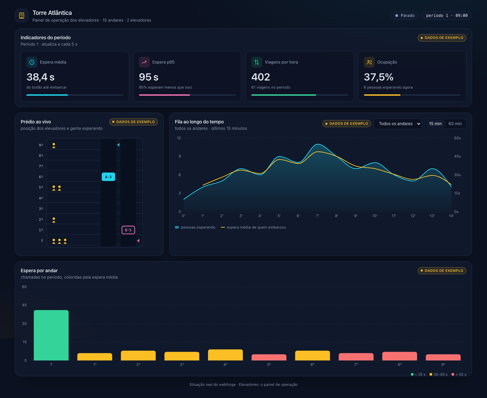

# Painel de operação — Torre Atlântica

> **Situação real do webforge.** A gerente predial da Torre Atlântica ganhou um
> painel de operação dos elevadores — bonito, mas de mentira: tudo nele são
> dados de exemplo. A API já existe e o prédio roda dentro dela. Sua missão é
> **ligar o painel à API**: indicadores, gráficos com filtros e o prédio ao vivo.



## Como rodar

Requisitos: **Node 22.13 ou mais novo** (recomendado o 24, veja `.nvmrc`).

```bash
npm install
npm run dev          # API em :3001 e painel em http://localhost:5173
```

Outros comandos (na raiz):

```bash
npm run typecheck    # tipos da API, do painel e do contrato
npm test             # testes (Vitest)
npm start            # compila o painel e sobe a API servindo tudo em :3001
```

## As etapas

Cada etapa vale XP na plataforma e só abre depois da anterior. Antes de enviar,
rode a **central do prédio** — as mesmas checagens da plataforma, com um
navegador de verdade:

```bash
npx playwright install chromium   # uma vez só
npm run central -- 1              # (2, 3 ou 4)
```

| Etapa | O que fazer | Onde |
|---|---|---|
| **1. Indicadores** | `obter()` e `buscarMetricas()`; o `useMetricas` busca a cada 5 s, marca a origem como `"api"`, mostra o erro da API e o botão "Tentar de novo" funciona | `apps/web/src/services/api.ts`, `apps/web/src/hooks/useMetricas.ts` |
| **2. Gráficos com filtros** | `GET /api/series` na API (validando `andar` e `janela`) e `buscarSeries()` + `useSeries` no painel, buscando de novo quando o filtro muda | `apps/api/src/routes/series.ts`, `services/api.ts`, `hooks/useSeries.ts` |
| **3. Prédio ao vivo** | `GET /api/eventos` com Server-Sent Events na API e `ouvirPosicoes()` + `useEventos` com `EventSource` no painel — sem polling | `apps/api/src/routes/eventos.ts`, `services/api.ts`, `hooks/useEventos.ts` |
| **4. Fim dos mocks** | Os hooks começam sem dados (`null`) em vez dos exemplos e nada em `src/` importa `mocks/`; tipos e testes passando | `apps/web/src/hooks/` |

Os pontos a implementar estão marcados com `TODO Etapa N`. Os componentes já
sabem mostrar carregando, erro e dados — você não precisa mexer neles.

Leia [`docs/arquitetura.md`](docs/arquitetura.md) e [`docs/contrato.md`](docs/contrato.md).

## Como enviar

1. Este repositório precisa ser **público** no seu GitHub.
2. Faça commit e push.
3. Na plataforma (Situações reais → Painel de operação), cole a URL e clique em
   **Validar**. A central roda `npm start` e abre o painel num navegador.
